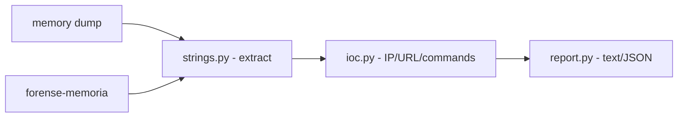

# forense-memoria-simples

**English** · [Português (Brasil)](README.md)

[](#) [](#) [](LICENSE)

## What it is

A **simple memory-forensics lab**: it extracts strings from a binary/dump, looks for **indicators of compromise (IOCs)** — IPv4 addresses, URLs and suspicious commands — and produces a **report** (text or JSON). It is an educational incident-response lab in pure Python (stdlib).

## Status

An educational security lab (defensive forensics), working and tested (19 tests).

## Features

- **String extraction** (`extract_strings`): pulls strings from a binary dump, with a configurable minimum length (default 4).
- **IOC detection** (`scan_iocs`): IPv4 addresses, URLs and suspicious commands.
- **Report** (`build_report`): text or JSON, with counts.
- **CLI**: `forense-memoria <file> [--min-len N] [--format text|json] [--output path]`.

## Architecture

A `forense_memoria_simples` package with `strings.py` (extraction), `ioc.py` (IOC detection) and `report.py` (output), orchestrated by the CLI.



## Stack

- Python ≥ 3.10, stdlib only
- pytest (dev)

## Repository layout

```
forense-memoria-simples/
├── pyproject.toml · BRIEF.md
├── src/forense_memoria_simples/
│   ├── strings.py   # string extraction
│   ├── ioc.py       # IOC detection
│   └── report.py    # report
├── tests/           # 19 tests
└── LICENSE          # MIT
```

## Prerequisites and installation

Python ≥ 3.10.

```bash
pip install -e .
```

## How to run

```bash
forense-memoria dump.bin --min-len 4
forense-memoria dump.bin --format json --output relatorio.json
```

## Tests and quality

Real command (verified by the agent):

```bash
PYTHONPATH=src python -m pytest tests/
# 19 passed
```

## Technical decisions and trade-offs

- **Strings + regex IOCs**: simple and transparent; the cost is limiting detection to known patterns.
- **No dependencies**: portable and auditable; in exchange, no advanced memory-analysis heuristics.

## Known limitations and roadmap

- It is a lab: it does not replace complete forensics tools (Volatility, etc.).
- The analysis covers basic strings/IOCs; no process reconstruction or advanced artifacts.

## Development process

An individual project by Kelvin Oliveira, built with orchestrated AI agents and reviewed by the author. The IOC pipeline and the review are the author's.

## License and author

MIT — Copyright (c) 2026 Kelvin Rebelo de Oliveira.

**Author**: [Kelvin Oliveira](https://github.com/KelvinOliveiraCode) · [Portfolio](https://kelvinoliveiracode.github.io/portfolio/)
