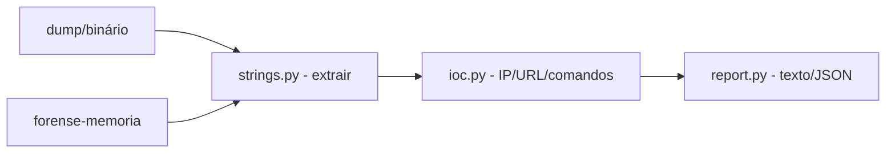

# forense-memoria-simples

[English](README.en.md) · **Português (Brasil)**

[](#) [](#) [](LICENSE)

## O que é

**Laboratório de forense de memória simples**: extrai strings de um dump/binário, procura **indicadores de comprometimento (IOCs)** — endereços IPv4, URLs e comandos suspeitos — e gera um **relatório** (texto ou JSON). É um laboratório educacional de resposta a incidentes em Python puro (stdlib).

## Status

Laboratório educacional de segurança (forense defensiva), funcional e testado (19 testes).

## Funcionalidades

- **Extração de strings** (`extract_strings`): recupera strings de um dump binário, com tamanho mínimo configurável (padrão 4).
- **Detecção de IOCs** (`scan_iocs`): IPs IPv4, URLs e comandos suspeitos.
- **Relatório** (`build_report`): em texto ou JSON, com contagens.
- **CLI**: `forense-memoria <file> [--min-len N] [--format text|json] [--output path]`.

## Arquitetura

Pacote `forense_memoria_simples` com `strings.py` (extração), `ioc.py` (detecção de IOCs) e `report.py` (saída), orquestrados pelo CLI.



## Stack

- Python ≥ 3.10, stdlib apenas
- pytest (dev)

## Estrutura do repositório

```
forense-memoria-simples/
├── pyproject.toml · BRIEF.md
├── src/forense_memoria_simples/
│   ├── strings.py   # extração de strings
│   ├── ioc.py       # detecção de IOC
│   └── report.py    # relatório
├── tests/           # 19 testes
└── LICENSE          # MIT
```

## Pré-requisitos e instalação

Python ≥ 3.10.

```bash
pip install -e .
```

## Como executar

```bash
forense-memoria dump.bin --min-len 4
forense-memoria dump.bin --format json --output relatorio.json
```

## Testes e qualidade

Comando real (verificado pelo agente):

```bash
PYTHONPATH=src python -m pytest tests/
# 19 passed
```

## Decisões técnicas e trade-offs

- **Strings + IOCs por regex**: simples e transparente; o custo é limitar a detecção a padrões conhecidos.
- **Sem dependências**: portátil e auditável; em troca, sem heurísticas avançadas de análise de memória.

## Limitações conhecidas e roadmap

- É um laboratório: não substitui ferramentas forenses completas (Volatility, etc.).
- A análise cobre strings/IOCs básicos; sem reconstrução de processos ou artefatos avançados.

## Processo de desenvolvimento

Projeto individual de Kelvin Oliveira, construído com agentes de IA orquestrados e revisado pelo autor. O pipeline de IOCs e a revisão são do autor.

## Licença e autor

MIT — Copyright (c) 2026 Kelvin Rebelo de Oliveira.

**Autor**: [Kelvin Oliveira](https://github.com/KelvinOliveiraCode) · [Portfólio](https://kelvinoliveiracode.github.io/portfolio/)
